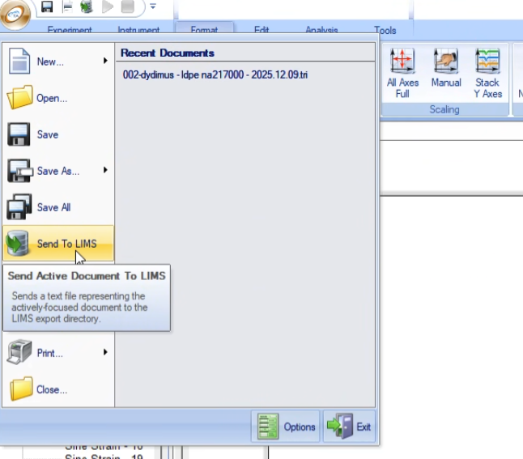
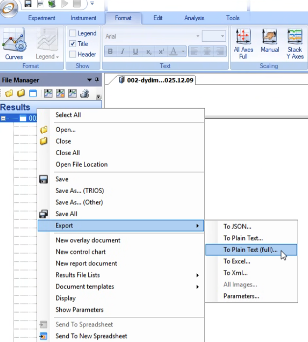

# hermes-rheo

[](https://pypi.org/project/hermes-rheo/)
[](https://pypi.org/project/hermes-rheo/)
[](#)
[](https://3mcloud.github.io/hermes-rheo/)
[](https://joss.theoj.org/papers/10.21105/joss.08753)
[](https://github.com/astral-sh/ruff)

`hermes-rheo` is a Python package for reading, visualizing and processing
rheological data.

It builds on the data model of [`piblin`](https://github.com/3mcloud/piblin):
instrument exports are parsed once into a common representation, so a
single transformation pipeline applies regardless of the source
instrument. Supporting a new instrument only requires a new file reader.

```python
from hermes_rheo import read_file, TriosRheoReader, SplitTemperatureSweep

# Read a temperature sweep and split it into individual frequency sweeps
experiment = read_file(
    "temperature_sweep.txt",
    file_reader=TriosRheoReader,
    create_composite_datasets=True,
)

frequency_sweeps = SplitTemperatureSweep(
    n_steps=1, temp_step_interval=[5.0], temp_tolerance=1.0,
)(experiment)
```

## Installation

```bash
pip install hermes-rheo
```

Python 3.10–3.13 is supported. Optional extras:

```bash
pip install "hermes-rheo[notebooks]"   # plotting style and video export for the tutorials
pip install "hermes-rheo[docs]"        # build the documentation
```

[`pyRheo`](https://github.com/mirandi1/pyRheo) (GPL-3.0, not on PyPI) is an
optional dependency used by `FitModel` for fractional and classical
viscoelastic models. Install it separately if needed:

```bash
pip install git+https://github.com/mirandi1/pyRheo.git
```

For development, [`uv`](https://github.com/astral-sh/uv) manages the environment:

```bash
git clone https://github.com/3mcloud/hermes-rheo
cd hermes-rheo
uv sync --all-extras
uv run pytest
```

## Documentation and tutorials

- [API reference](https://3mcloud.github.io/hermes-rheo/)
- [Tutorial book](https://3mcloud.github.io/hermes-rheo/tutorials/)

The notebooks are also in [`tutorial_notebooks/`](tutorial_notebooks/):

| # | Topic |
| - | ----- |
| 1 | Reading and visualizing common rheological datasets |
| 2 | OWChirp wave design |
| 3 | Reading and visualizing OWChirp experiments |
| 4 | Time-temperature superposition |
| 5 | Time-curing superposition |
| 6 | Mutation number |
| 7 | Visualization helpers |
| 8 | Temperature ramp analysis |
| 9 | Kymographs (TORCh) |
| 10 | Recovery rheology |
| 11 | Rheological model fitting |
| 12 | Frequency to time relaxation modulus |
| 13 | Relaxation spectrum (pyReSpect) |

## File readers

| Instrument / software | Reader |
| --------------------- | ------ |
| [TA Instruments](https://www.tainstruments.com/) TRIOS `.txt` | `TriosRheoReader` |
| [Anton Paar](https://www.anton-paar.com/) RheoCompass `.csv` | `RheoCompassReader` |

`hermes_rheo.read_file` selects the reader from the file extension, or takes
one explicitly through `file_reader=`.

### Exporting TRIOS files

`TriosRheoReader` needs the full step-header metadata (geometry, calibration,
wave and step parameters). Two TRIOS export paths write it:

- **TRIOS 5 and earlier:** *Send To LIMS*.

  
- **TRIOS 6.0 and later:** *Export* → *To Plain Text (full)…*.

  

The plain *To Plain Text* option strips the metadata and cannot be parsed.

For other formats, write a custom reader and reuse the transforms unchanged.

## Development

- Code style: [ruff](https://github.com/astral-sh/ruff) (`ruff check .`, `ruff format .`).
- Tests: [pytest](https://docs.pytest.org/) (`uv run pytest`).
- Docstrings: [NumPy format](https://numpydoc.readthedocs.io/en/latest/format.html);
  API docs are built with [Sphinx](https://www.sphinx-doc.org/), tutorials with
  [MyST](https://mystmd.org/).
- Versions are derived from git tags ([PEP 440](https://peps.python.org/pep-0440/)).
- Commit messages follow [Conventional Commits](https://www.conventionalcommits.org/).

Bug reports and contributions are welcome through
[GitHub issues](https://github.com/3mcloud/hermes-rheo/issues).

## Citation

If you use `hermes-rheo`, please cite:

> Perego, A. *et al.* (2025), *hermes-rheo: An open-source Python package for
> rheological data analysis*, Journal of Open Source Software.
> DOI [10.21105/joss.08753](https://doi.org/10.21105/joss.08753).

See [`CITATION.cff`](CITATION.cff) for the full metadata.

Publications using `hermes-rheo`:

- Perego, A. *et al.* (2025), *Rheologica Acta*.
  DOI [10.1007/s00397-025-01511-0](https://doi.org/10.1007/s00397-025-01511-0).
- Vadillo, D. C., Perego, A. *et al.* (2026), *TORCh: Thermally Optimised Ramped
  Chirp*, Macromolecules.
  DOI [10.1021/acs.macromol.6c00679](https://doi.org/10.1021/acs.macromol.6c00679).

## Contact

[aperego@mmm.com](mailto:aperego@mmm.com)

## License

[MIT](LICENSE)
